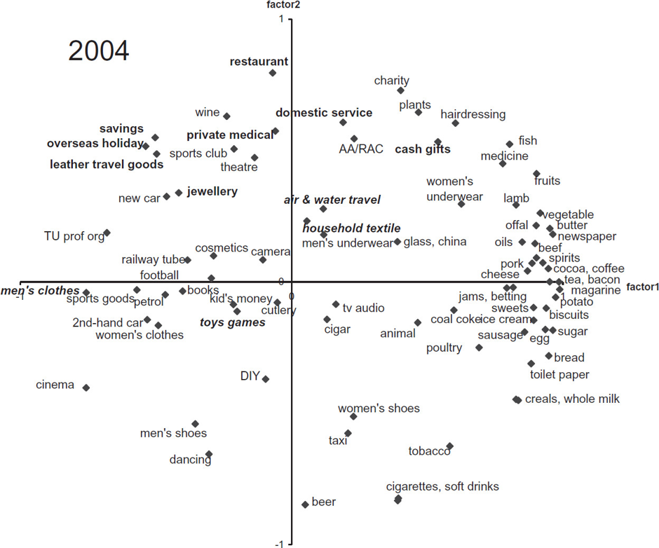
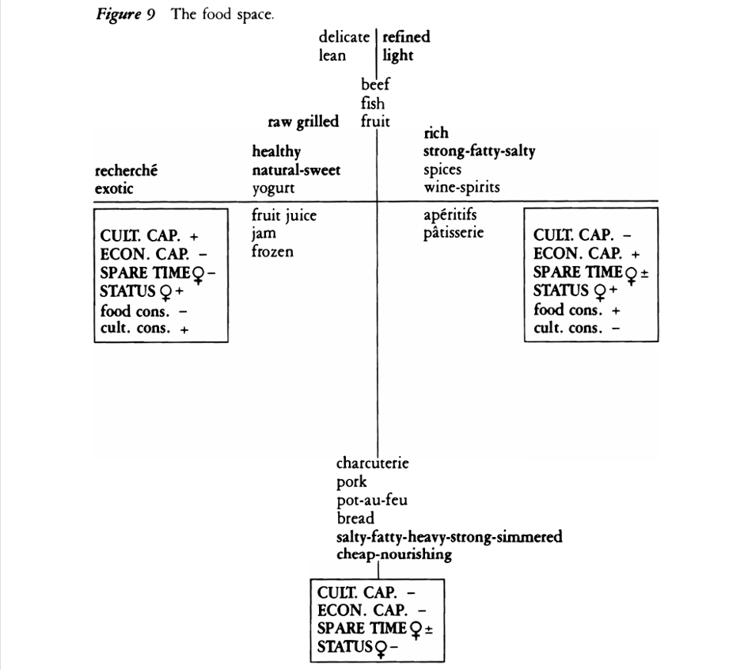
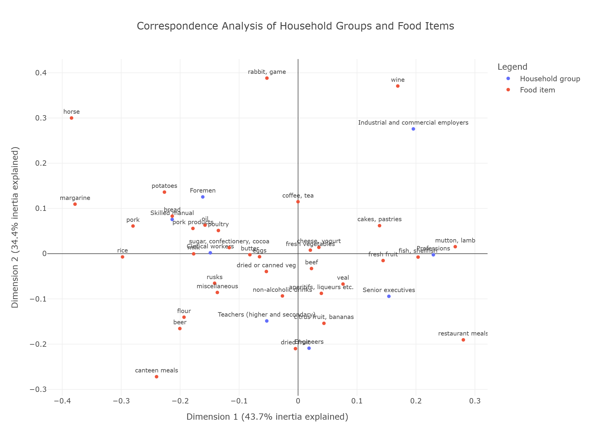

{width="100%"}

As a researcher and teacher, my main interest is in class, politics and social power. There’s obviously some spillover into civilian life. I’m a socialist and a sociologist. But when not working myself to death in the ruins of the UK academy a lot of my time and energy is put into food and cooking. Doubt you’re interested in what I get up to in the kitchen, and don’t worry, this post isn’t about me. Just to say that it lies at the intersection of two of my enduring obsessions: class and food.

If you share an interest in either – and especially in both – I’d really recommend a podcast called *The Full English*, which recently returned for a new series. It explores food, class, culture and nationality identity in Britain, and is hosted by Lewis Bassett, a sociologist and chef who I’ve worked with. Lewis has a book out with the same title from [Verso](https://www.versobooks.com/en-gb/products/3312-the-full-english), which I haven’t read yet, but is on my Christmas list, and I’m very much looking forward to reading.

I don’t know that much about the sociology of food *per se*, but I’ve spent plenty of time with the sociology of class and taste, in which food often features. Like research on gentrification, the focus here is often on cultural differences between the middle and working class. This isn’t just a topic of academic interest. Everyone who pays attention to the UK commentariat knows that class is determined by whether you like hummus, sourdough and wine, or prefer bacon butties, pies and pints. Purely cultural definitions of class, absent of any notion of wealth and power, can take you to silly places. But I wouldn’t be much of a sociologist if I thought culture doesn’t matter, and obviously income and class background shape what we eat, and what we like eating.

## The Food Culture of Britain's 1%

Not that I really have time, but the other day I started trying to piece together a social history of the eating habits of Britain’s ruling classes. Looks like this is going to take me a while, but I’ll post something here when I’m eventually done. Anyway, I came across [this article](https://journals.sagepub.com/doi/10.1111/j.1467-954X.2008.00769.x) which tries to capture changes to household expenditure in the UK amongst the top 1% over several decades using the Family Expenditure Survey (Majima and Warde 2008).

Interesting read, although it was rather slim pickings on food and drink, which seem to be there in the data, but aren’t brought to the fore that much in the discussion. Back in the 1960s the very rich in Britain spent proportionally more of their household income on wine and spirits than everyone else. By 2004, they had lost interest in spirits and weren’t spending much more (proportionally) on wine. Guess this is because everyone else started drinking it. They still spent a lot more on meals out, and as we’ll see there’s a bit more on food in the diagrams.

The authors use Factor Analysis to summarise the associations between household budget items in the survey. Factor Analysis is a dimension reduction method. I’ve never completely understood its relationship with similar methods, but it usually gets used when you have a few variables that correlate. Rather than having to pick a favourite or take the mean value of all of them, you can use Factor Analysis to combine them all into a single ‘latent’ variable (called a factor). The idea here is that there’s an underlying unobserved variable you are capturing with e.g. a set of survey questions.

Let’s say what you want to measure is how posh someone is in England, but the only observations you have are where they went to school, how they pronounce ‘class’ and ‘scone’, what they call their evening meal, and if they go on skiing holidays. In layperson’s terms, if these overlap, they could be combined into a single ‘factor’ representing poshness rather than using the actual observed variables. Okay, this isn’t the best example to explain Factor Analysis, because it’s used for continuous variables (often a scale), rather than categories, but you get the idea. In the figure below, the authors use two ‘factors’ from the 2004 household spending data as axes to produce what they call a ‘space of lifestyles’.

These sorts of plots will be familiar to anyone who’s been Bourdieu-pilled. For those who haven’t, what you’re seeing here is a two-dimensional representation of statistical associations between the categories of expenditure. Looks to me like the horizontal axis represents durable v. non-durable items and leisure activities, and the vertical axis is class/income based.

Households who spend a higher proportion on gambling are also more likely to spend more on margarine, jam, bacon and potatoes. Households who spend more on women’s underwear are also more likely to spend more on fruit, fish and lamb. The forms of expenditure that are proportionally much higher amongst the 1% (in 2004) are shown in bold. Looks like a lot of conspicuous consumption to me.

Factor Analysis is often used for regression models, but the sort of approach that inspired this article departs from causal analysis. Rather than trying to isolate distinct effects, the aim is to ‘map’ a bunch of associations and represent a whole ‘social space’ pictorially. What you typically get from plotting two axes in this way is four quadrants representing different social types with relatively low or high levels on each dimension. Pierre Bourdieu looms large here and I was reminded reading that article that his seminal work, *Distinction*, devotes quite a few pages to food specifically.

## *Distinction* Revisited

One thing a lot of people get wrong about Bourdieu when they rely on secondary sources and summaries is they think of him as a social theorist. This is understandable because his writing can be quite dense; he developed a rather idiosyncratic theoretical vocabulary; and even his most enthusiastic proponents will concede that he was French. But if you read his work, it’s clear that for all that he was a researcher who built his theoretical frameworks around empirical investigations, and vice versa. Point is he used lots of data and wasn’t just idly theorising. There are 26 data tables in *Distinction* and 21 Figures.

Revisiting the section on food in *Distinction* I was expecting a similar sort of plot to the one I reproduced above. But most of the diagrams are schematic representations of the associations in the data like the one below.

The basic idea conveyed by this diagram is that taste in food needs to be understood on two dimensions. Not just income, which is the vertical axis, but also famously *cultural capital*, which is the horizontal axis. If you’re low on both, you’ll like cheap, nourishing foods. If you are rich and ‘cultured’ you will favour refined, healthy food like fresh fruit, veal and seafood (Bourdieu 1984, 376).

*Distinction* has two data tables reporting food expenditure by different occupational groups, so similar to the data used by Majima and Warde (2008). A few weeks back I downloaded a nice Python package called [Prince](https://pypi.org/project/prince/0.7.1/) that can run several dimension reduction methods (R is actually better for this if that’s your thing). So I thought it would be easy enough to produce a proper plot using Bourdieu’s data tables on food expenditure. Which it was. In fact, the hard part was getting the data from the PDF into a CSV. I tried Tabula, which didn’t work, and when I asked work’s rather intrusive AI about other tools I could use it went rogue and extracted the data for me. Just needed to tidy up a few transcription errors in the two tables and then it was plain sailing.

Most Bourdieusian analyses of ‘social space’ use Multiple Correspondence Analysis. With MCA the cases are individuals who along with the categories of the variables are plotted in the social space. But with these food budgeting tables there’s no individual-level data, just the mean expenditure for each item for each social group. So, for producing the plot below I used simple Correspondence Analysis, which visualises the association between two categorical variables, in this case social class and food items. It’s basically a visual representation of associations in a crosstab (a matrix where the values are counts of how frequently two categories are observed together in the data). In this case though the values are the mean proportion of a household budget spent on a given food item by a given social group.

Anyway, here you go, the fruits of my labour:

Python isn’t good at arranging labels on diagrams like this. Originally I made an interactive plot that displays the labels for a social group if you hover over the data point. But this didn't seem to embed on the webpage very well, so I just went with the static plot.

A few basic points for making sense of a plot like this. First the categories of a variable will tend to be closer on the ‘map’ if they are both relatively more associated with a category of the other variable. So food items that are closer together are being bought more frequently by the same social groups, and social groups that are closer together are buying the same sorts of foods. Strong oppositions will tend to appear either side of the ‘origin’ (that is the middle point where the two axes cross). So people who buy wine are much less likely to buy beer, and people who spend more on going to restaurants spend less on potatoes. Finally, categories that are more dispersed amongst the other variable are closer to the origin, and those that are more concentrated will appear at the edges. So the real differences are at the periphery, not the centre.

We can see here fairly clearly the sorts of associations Bourdieu discusses in *Distinction*. The vertical axis broadly represents ‘cultural capital’ (although annoyingly high is at the bottom and low at the top) and the horizontal is ‘economic capital’.

The working-class groups in the top left quadrant are more associated with potatoes, margarine, pork and \[shaking my English head\] horse meat. Your business owners in the top right share a lot with the senior executives and professionals (seafood, fresh fruit and lamb), but are particularly into cake and fine wine. Weirdly they also spent a lot on lard. So much so that I had to remove it from the data because it massively skewed the plot.

Your senior executives spend a lot more on restaurant meals, while the teachers prefer to pop to the work canteen for lunch, and are much more into beer. The teachers were also cider enthusiasts. So much so that I removed this from the data as well. Don’t know enough about French culinary culture in the 1970s to figure out what this means. In the UK its regional and traditionally not seen as sophisticated, although in last few years I’ve seen some expensive artisan cider popping up around London. Guessing from the placement of flour that teachers are also doing more baking.

Bourdieu of course has a lot to say about all this. Here’s a taster from *Distinction*, which if you like this sort of thing you really should read (but maybe skip the starter chapters and go straight to the main course).

> Thus, when one moves from the manual workers to the industrial and commercial employers, through foremen, craftsmen and small shopkeepers, economic constraints tend to relax without any fundamental change in the pattern of spending (see figure 9). The opposition between the two extremes is here established between the poor and the rich (nouveau riche), between *la bouffi* and *la grande bouffi*; the food consumed is increasingly rich (both in cost and in calories) and increasingly heavy (game, foie gras). By contrast, the taste of the professionals or senior executives defines the popular taste, by negation, as the taste for the heavy, the fat and the coarse, by tending towards the light, the refined and the delicate (see table 18). The disappearance of economic constraints is accompanied by a strengthening of the social censorships which forbid coarseness and fatness, in favour of slimness and distinction. The taste for rare, aristocratic foods points to a traditional cuisine, rich in expensive or rare products (fresh vegetables, meat). Finally, the teachers, richer in cultural capital than in economic capital, and therefore inclined to ascetic consumption in all areas, pursue originality at the lowest economic cost and go in for exoticism (Italian, Chinese cooking etc.) and culinary populism (peasant dishes). (Bourdieu 1984, 185)

## Culture and Class Politics

Needless to say, the class structure today is radically different to 1972, when the data for the above figure was collected. More recent research on the sociology of culture has emphasised the emergence of *omnivorous* taste, which disrupts the high v. low cultural distinctions of the 20^th^ century (Ferrant 2018; De Vries and Reeves 2022). The idea here is that cultural superiority is increasingly demonstrated less by knowledge of high culture, and more by broad yet discriminating taste. Contrary to my clickbaity title, posh people in the UK do eat sausage rolls. It’s just that they’ll probably spend £12.50 on a high-end sausage roll at a farmer’s market, rather than picking one up from Greggs or a petrol station. Meanwhile, research on elites suggests that they increasingly emphasise their *ordinariness* as a legitimation strategy, rather than their cultural distinction (Friedman and Reeves 2020).

Food aside, does any of this matter politically? I think so. The left’s contention is that political coalitions should be built around shared economic interests, rather than cultural affinity. The right, in response, has relentlessly pushed culture as the key determinate of class, seeking to split off the liberal upper-middle classes from the working class and from the *petit bourgeoise*, with which the capitalists have historically been able to make common cause politically. But the arguments the right mobilise are not spun out of thin air. Cultural differences between and within social classes are a social fact.

The news media and culture industries have been important here, since they operate in consumer markets. Algorithmic media also feeds on cultural differences, serving back to us content that people like us liked, using the same sorts of dimension reduction methods that were popularised in social science by Bourdieu. But they are working with and reproducing real social divisions. I guess what I’m saying is that the left should not embrace culturalist definitions of class, but should be conscious that these are real tendencies that need to be effectively navigated. They weren’t just dreamt up by French sociologists or the ideologues of the ruling class.

**References**

Bourdieu P. (1984). *Distinction: Critique of the Judgment of Taste*, London: Routledge.

De Vries, R., & Reeves, A. (2022). What does it mean to be a cultural omnivore? Conflicting visions of omnivorousness in empirical research. *Sociological Research Online*, *27*(2), 292-312.

Ferrant, C. (2018). Class, culture, and structure: Stratification and mechanisms of omnivorousness. *Sociology Compass*, *12*(7), e12590.

Friedman, S., & Reeves, A. (2020). From aristocratic to ordinary: Shifting modes of elite distinction. *American Sociological Review*, *85*(2), 323-350.

Majima, S., & Warde, A. (2008). Elite consumption in Britain, 1961–2004: results of a preliminary investigation. *The Sociological Review*, *56*(1_suppl), 210-239.